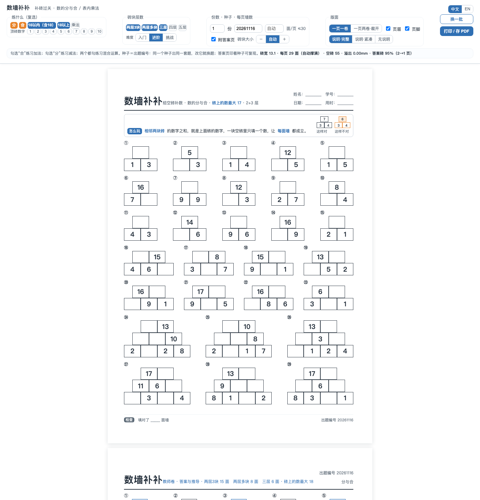

# 数墙补补 · Number Wall Fill

一个**单文件、离线、零依赖**的小学数学游戏卷生成器。双击 `数墙补补_生成器.html` 就是出题器：
一面墙从下往上错缝叠砖，**下面相邻两块砖的数合起来等于上面那块**，空出来的砖由孩子补——
练的是**数的分与合**（几个和几合成几、几能分成几和几），也能整档切成**表内乘法口诀**。
排好的卷子是一张 A4，浏览器里直接打印或存 PDF；界面和纸面都能切中英文。

不用装东西、不用联网、不用注册，题目和版面全在这一份文件里算完。

上图是无头浏览器对真实页面的整屏截图（出题编号 `20261116`，默认配置），不是设计稿。

---

## 30 秒上手

1. 双击 HTML，用 Chrome / Edge / Safari 打开。
2. 左上角「练什么」勾：`分`（减法）／`合`（加法）／`乘法`（表内口诀），再定数域和砖块层数。
3. 右侧定一次出几份（1–6）、用什么出题编号、一页放几面墙（留空＝自动撑满）。
4. 看下方状态条那一行读数：砖宽、每页几面、几块空砖、溢出毫米、答案页压到几页，一屏读完。
5. 点「打印 / 存 PDF」：纸张 **A4**、边距选**默认**、缩放 **100%**、勾上**打印背景**（砖的描边和浅底靠它）。

要不同的题就点「换一批」（出题编号自动加一）；要同一套题回填那个编号即可。

## 这个游戏练什么

一面墙从下往上错缝叠砖：下面两块 `3`、`4` ⇒ 上面是 `7`；给了上面 `7` 和下面一块 `3`
⇒ 孩子自己推另一块 `4`。一块空砖只填一个数，让每面墙都成立，页脚留一行自检「填对了 ＿＿ 面墙」。

- **合**（知道下面两块，求上面）＝进位加法的底子。
- **分**（知道上面和下面一块，求另一块）＝退位减法的底子，凑十、破十都在这一步里。
- **乘法**（相邻两块相乘等于上面那块）＝表内口诀，这时 1–10 那一排按钮读作"练几的口诀"，
  可以只勾其中几句。
- 卷头那句「砖上的数最大 N」**只取卷面看得见、推得动的数**，不给孩子出推不出来的题；
  某个组合凑不满一行时会自动收敛，并在状态条点名说收敛掉了哪一带、原因是什么。

## 选项一览

| 组 | 能选什么 | 默认 |
| --- | --- | --- |
| 练什么 | `分`／`合` 可同勾（＝混着出）；`乘法` 单独一档，与加减法不混排。数域 `10以内（含10）`＝2–10、`10以上`＝11–20。`10以内` 下还能勾顶砖取 6／7／8／9／10 | 分＋合、两档数域都勾、顶砖不限 |
| 砖块层数 | 两层3块／两层多块／三层／四层／五层，可多勾混排，带序固定从易到难 | 前三种 |
| 难度 | 入门（三成空砖）／进阶（四成半）／挑战（六成）——只管挖几块，不管数字大小 | 进阶 |
| 份数 · 编号 · 每页墙数 | 一次 1–6 份；出题编号 1–99999999（同编号必出同一套题）；每页墙数留空＝自动撑满，填数就固定（每卷上限 30 面） | 1 份 · `20261116` · 自动 |
| 版面 | 一页一卷／一页两卷·裁开（一张纸上下两卷，中间一条虚线，答案页同样两张半页）；页眉／页脚开关；说明三档（完整＝玩法＋对错示例、紧凑、无说明） | 一页一卷、页眉页脚开、说明完整 |
| 语言 | 右上角开关，界面和纸面一起切，切哪一种印哪一种 | 中文 |

## 版面是算出来的，不是写死的

砖宽由"撑满解算"现算：从大到小试砖宽档位，取放得下且不溢出的最大档，所以状态条那串读数
是量出来的。默认配置（分＋合同勾、两档数域、前三种层数、进阶）实测：

| 读数 | 默认值 |
| --- | --- |
| 砖宽 | 13.13mm |
| 每页墙数 | 29 面 |
| 空砖 | 55 块 |
| 溢出 | 0.00mm |
| 页数 | 2 页＝学生 1 ＋答案 1 |
| 一页两卷时砖宽 | 降到 12.43mm（一张纸两卷） |

右侧常驻一条 0.31mm 安全缝，防打印时最右一列砖被裁掉；打印态卷面 `margin:0 auto`，
所以边距选"默认"或"无"都左右各 13.00mm。

## 答案页

答案页列出同一套墙的完整砖塔，每面墙旁边一行推导算式（`3 + 4 = 7`、`21 分成 9 和 12` 这种），
教师单独留一份，学生卷上不带任何算式。答案页超过一页时**自动按比例缩砖压进一页**，
状态条会写"答案砖 95%（2→1 页）"——缩的是砖的尺寸，**题一道不删**。

## 中英双语

界面与纸面**整页一起切**，不做中英混排；切英文就印英文卷。数字与运算符号不动，
玩法句、状态条读数、报错原因句、导出 PDF 的建议文件名都有对应译文并一起切。
英文标签更长时走版面重解（砖宽、每页墙数跟着调），不靠压字号；窗口窄到自己放不下时才折行。
想在打开时就定语言，地址栏文件名后加 `?lang=en` 或 `?lang=zh`。

## 出题编号：同一套题随时能再印一次

卷头印着出题编号，答案页页脚也有同一个号。**同编号 ＋ 同配置＝同一套题**，
隔天补打、两个班用同一张卷子都对得上号，换浏览器也一样。「换一批」就是编号加一。

## 隐私

全程本地运行：文件里没有任何网络请求，不上传、不收集、不需要账号。
选项和语言偏好只存在这台浏览器的本地存储里，清掉浏览器数据就没了。
卷头只有四个空白栏位（姓名、学号、日期、用时）<!-- 这里出现的几个词是卷面上印的空白栏位名，纸上只有下划线，本工具不收集任何个人信息（审查例外） -->，
纸上印的是下划线，写不写由填卷的人自己决定。

## 这个仓库里有什么

| 文件 | 作用 |
| --- | --- |
| `数墙补补_生成器.html` | 主产物，双击即用，单文件 186,999 字节，无外部依赖 |
| `references/rules-and-generation.md` | 玩法与出题口径：规则为什么长这样，改设置或调题之前读它 |
| `CHANGELOG.md` | 版本记录 |
| `LICENSE.txt` | CC BY-NC-SA 4.0 全文 |
| `assets/preview.png` | README 首屏那张真实截图 |

**怎么自己验一遍**（不用读代码，页面里就能验完）：

1. 连点三次「换一批」，每批都要填得完——每面墙都能从卷面印出来的数推下去。
2. 记下出题编号，回填进去再打印一次，两次应当是同一套题。
3. 打印预览数页数：一页一卷是"学生 1 页＋答案 1 页"；一页两卷时一张纸两卷，答案半页跟在后头。

出题内核的数学回归（累计 1,977,382 条断言、0 失败）与版面、打印、双语、跨浏览器引擎的
量测脚本在开发侧跑，不放进这个仓库；仓库里只放生成器和这几份说明文档。

## 许可与署名

- 许可：**CC BY-NC-SA 4.0**（署名 — 非商业性使用 — 相同方式共享），全文见 [`LICENSE.txt`](LICENSE.txt)。
  拿去打印、上课、改题都行；商用需要先另做授权。
- 署名：**粉笔与代码**。
- 源码仓库：<https://github.com/seahp/number-wall-fill>

---

## English

`Number Wall Fill` turns a single offline HTML file into a printable math game sheet —
no install, no network, no account, and the interface and the page are both bilingual.

Each wall is a stack of offset bricks. **The two bricks under a brick combine to make the
number above it**, and the child fills in the blank bricks: `3` and `4` below ⇒ `7` above;
given `7` and `3` ⇒ work out the `4`. One number per blank brick, every wall must hold, and
the page footer leaves a self-check line. Tick `Join` for addition practice, `Split` for
subtraction (the ground under carrying and borrowing), both for a mix, or switch to
`Multiply` for times tables — there the 1–10 row reads "which tables to practise".

- Walls from 2 to 5 rows, five wall shapes, mixable on one page from easy to hard.
- Numbers up to 10 (incl. 10) or 11–20, plus an optional cap on the top brick (6–10).
- Three difficulty levels = how many bricks stay blank (30% / 45% / 60%).
- 1–6 different sheets at a time; two sheets per A4 page with a cut line.
- Brick width is solved, not hard-coded: the default page fits 29 walls at 13.13mm with
  0.00mm overflow, and the answer page shrinks to one page without dropping a question.
- Every sheet carries a **set number**: same number plus same settings reproduces the exact
  same questions, in any browser — reprint tomorrow, give two classes the same paper.

Only numbers printed on the sheet are used as givens, so nothing on the page is unworkable.
When a combination can't fill a row the generator converges it and says which band and why
in the status line instead of quietly changing the rules.

Print with A4, default margins, 100% scale, background graphics on. Open directly in English
with `?lang=en` in the address bar.

Everything runs locally: no network requests, no third-party scripts, no analytics. Options
and language preference live in this browser's `localStorage` only. The header has four blank
fields for the writer to decide about (name, student number, date, time spent)<!-- 审查例外：以上均为卷面空白填写项标签，纸面上只有横线，不含真实个人信息 -->.

Licensed **CC BY-NC-SA 4.0** — attribution, non-commercial, share-alike. Full text in
[`LICENSE.txt`](LICENSE.txt). © 2026 **粉笔与代码 (Fenbi yu Daima)**.
